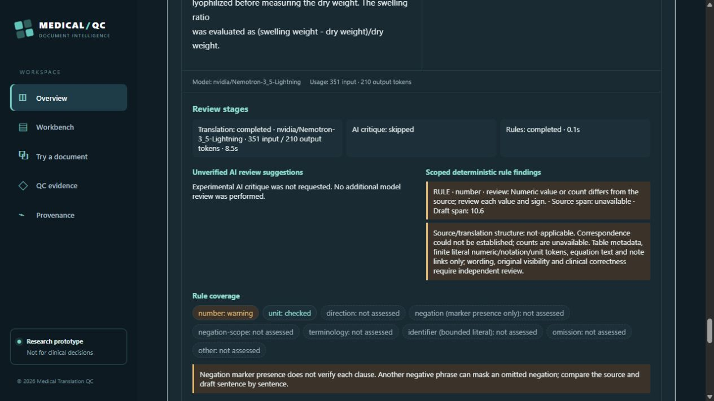

# MTQC r7 - additional real-paper testing and judge access

This is a research prototype for reviewer-approved short excerpts. The hosted runtime is `710bb1ac3702df2bd36ff2cf89ddbd2a382e9dca`; the r7 source snapshot is identified by tag `r7-20261030-final`. Later release documentation does not change the runtime's application source. R5/r6 archives and all earlier failures remain historical artifacts.

## Judge test route

1. Open the [public app](https://mtqc-nebius-2026-hyunstudio.azurewebsites.net/). No judge login, key or payment is required. Saved examples and editable downloads need no model call.
2. For a model example, select **Arterial-venous anatomy / Figure1**, a target, and **Translate fixed excerpt**. Repeated fixed examples may be cached. This drafts a caption, not the paper.
3. For a distinct excerpt, use a rights-cleared non-sensitive English PDF up to 2 pages or PNG/JPEG up to 10 MiB. Compare the extraction with the source, select/merge intended text regions, save corrections and verify them. Check the derived preview, choose a target and confirm source review/rights. Click **Translate and review excerpt** once, with experimental critique unchecked.
4. Inspect source, draft, token metadata, warnings and not-assessed categories. The additional microfluidic test changed **0.6 s to10.6 s** and the numeric rule flagged it. An ultrasound draft translated medical **phantom as ghost**; terminology remained not assessed. Neither a returned draft nor no findings is medical clearance. Do not enter patient data.

## New executed scope

- Three new CC BY 4.0 Frontiers papers: ultrasound phantom11 pages, cardiac MRI10 pages, microfluidic electrodes9 pages. Seventeen compliant selections covered all30 physical pages in the actual hosted app; whole-source previews were visually compared with independent original renderings. No gross missing source page/figure or clipping was observed. This is source rendering, not translated-layout fidelity or whole-paper translation.
- Table titles produced3 unresolved 1x1 placeholders with **zero recovered cells**. Figure links and proposed reading order remain unreviewed. Three fixed-crop local OCR runs produced1/82/32 unreviewed labels with substantial graph/small-text errors; none is accepted translated-figure output.
- Three new model dispatches only: ultrasound draft 289/136 tokens, MRI failure without observed usage, then microfluidic draft 351/210 tokens. No retry or critique. Both returned drafts had quality errors as described above. These are not a clinical sample or an all-language score.
- Twelve malformed API cases and six malformed/oversized file cases were held before provider use; a source-switch race was checked. Unsaved main text/type/box now holds excerpt admission and clears consent. Saved corrections require verification again; an exact revert can reuse saved verification with fresh consent. Versioned module URLs and code revalidation repair stale deployed code; deployment ZIP timestamps use UTC.
- Fifty related money regression tests passed. Exact runtime source passed [Windows and Ubuntu clean-clone CI](https://github.com/HyunStudio/MTQC-Medical-Translation-QC/actions/runs/41060024476). Older software/model evidence is inherited only at its original scope.

## Explicitly authorized operating policy

`reserved-budget-v2` uses **USD 5 per KST day / USD 100 cumulative / USD 0.15 per run**. It requires explicit daily/total configuration and retains all previous spending and the prior hold. These are authorized expenditure ceilings, not a verified account balance or a provider billing hard cap. No automatic top-up, retry, model substitution or budget reset.

Every dispatched v2 call permanently consumes its maximum reservation (currentlyUSD 0.06334656 at configured tax1), even if a later genuine bill is smaller. Actual billing remains unknown without a real receipt. A finished failure with no observed usage, or valid priced usage, permits the next caller only after its run owner releases. No-observed-usage includes errors before response/body parsing, not only network timeouts. Invalid observed usage/model, active/orphaned requests, corrupt ledgers, exhausted limits, expired authorization and unaccepted legacy failures still block.

The earlier MRI failure retains unknown-cost/failed status and its full reserve under a separate explicit one-call loss acceptance. It was not retried or falsely reconciled. Schema 3 makes older tools fail closed. Existing100 lifetime attempts,3 requests/client/hour,20 global/hour and single upstream concurrency remain; at tax1 at most78 new one-call dispatches fit a full unused KST day. Access is bounded, not unlimited or guaranteed continuous uptime. The owner service end remains December 31, 2026 at 23:59 KST; this is not a promotional-credit expiry claim.

Activation's controller exited on a UTC/KST timestamp string mismatch after the actual settings were applied. A separate read-only check verified the same instant, authorized settings and unchanged post-import accounting. Original outer failure remains failed. After the final paper call, attempts11->12, all previous entries stayed intact, a fifth full reservation remained pending and admission stayed available. Estimated costs are not settled charges.

## Source, rights and limits

Use the root README with .NET 10 SDK and Node 24: npm dependencies/client build, .NET Release build, fixture validation and local server. Local inference/native integration stays OFF by default. No provider key or Word is needed for saved examples and local extraction. The older Windows engine and installer are separate; second-PC installation is not certified by this web package.

First-party Apache-2.0 and the five-file owner grant in LICENSE-SCOPE.txt remain. Scientific and third-party rights are separate. New study inputs: Songsaeng et al.(2024), [doi 10.3389/fphy.2024.1456478](https://doi.org/10.3389/fphy.2024.1456478); Kokhanovskyi et al.(2025), [doi 10.3389/fcvm.2025.1572318](https://doi.org/10.3389/fcvm.2025.1572318); Pourmostafa et al.(2024), [doi 10.3389/fbioe.2024.1421592](https://doi.org/10.3389/fbioe.2024.1421592), each CC BY 4.0. The new warning screenshot adapts the last paper's text with an unreviewed AI draft, not author endorsement.

The [2:49 video](https://youtu.be/954tVuF-6Qw) predates these fixes and tests and labels historical inference/local artifacts. General original-PDF/math/figure reconstruction, accurate small-label OCR, whole-book translation and all-language medical accuracy remain incomplete. Independent clinical expert review is **0/15**. No organizer-eligibility certification is claimed.

Screenshot source text: Pourmostafa et al.(2024), DOI10.3389/fbioe.2024.1421592, CC BY 4.0; adaptation consists of the selected excerpt, unreviewed AI draft and application review display. It does not imply source-author endorsement.
